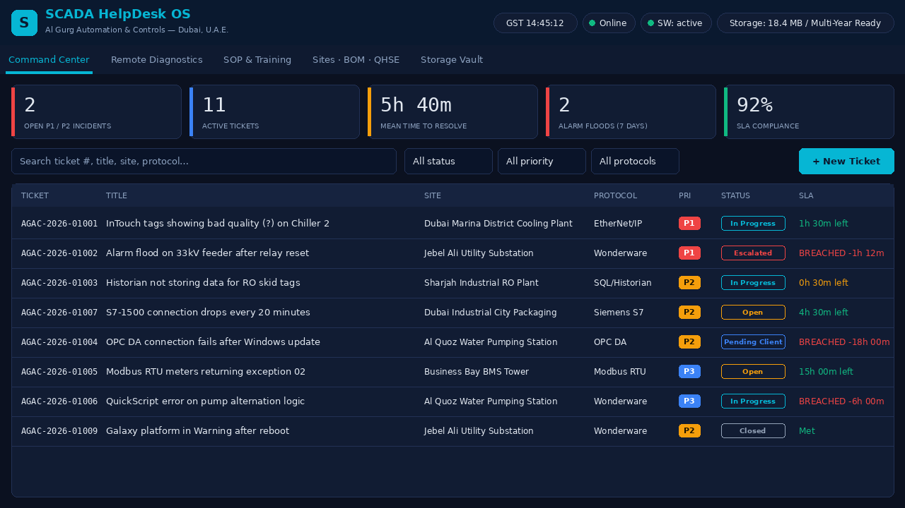
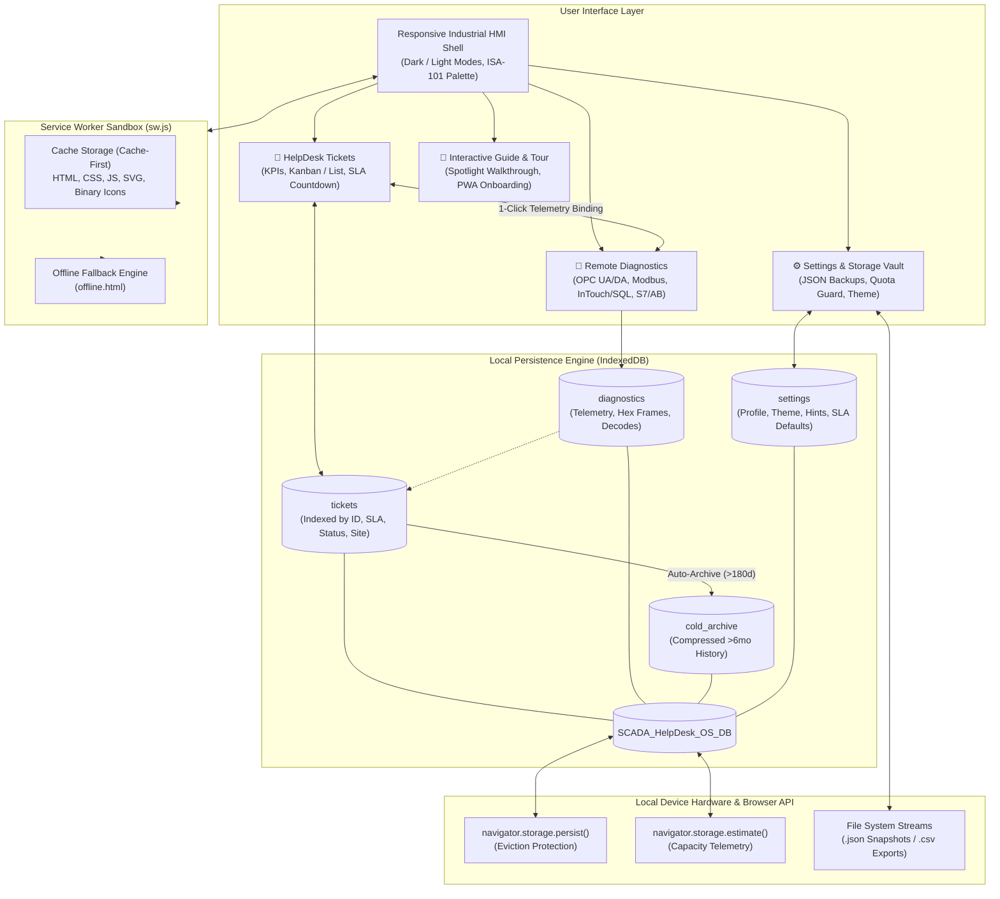

<div align="center">


# SCADA HelpDesk OS
### Automation & Controls — Dubai, U.A.E.

**A zero-dependency, offline-first Progressive Web App (PWA) for industrial SCADA/PLC technical support.**  
*Log plant calls, diagnose OPC/Modbus/Wonderware issues in plain English, attach telemetry to tickets, and track SLA resolution.*

[](manifest.webmanifest)
[](#storage-engine-23-years)
[](#run-it)
[](#notes)

<br/>



</div>

---

## Quick Start

PWAs require `http://localhost` or a secure **HTTPS** origin to enable the Service Worker offline cache and the native browser install prompt.

```bash
# Clone or navigate to the project directory
cd SCADA-HelpDesk-OS-PWA

# Start a local static server
python3 -m http.server 8080
```

1. Open `http://localhost:8080` (or your static host, such as GitHub Pages).
2. Open the app once while online to populate the offline cache.
3. Click **⬇ Install App** in the header to install it as a standalone desktop or mobile application. The app functions indefinitely with zero internet access.

---

## System Architecture

The application runs entirely on the client edge within the browser sandbox. No external servers, cloud databases, or CDN services are queried during runtime.



---

## Core Workspaces & Capabilities

| Workspace | Module Icon | Description & Key Functions |
|---|:---:|---|
| **HelpDesk Tickets** |  | Real-time industrial incident tracking. Includes live SLA countdown timers (P1 Critical to P4 Low), multi-project site filters, quick-fill symptom templates, search cursor pagination, and printable Client Service Reports. |
| **Remote Diagnostics** |  | Guided troubleshooting workbench with four built-in engines:<br/>• **OPC DA/UA**: Hex quality code decoder (`0x00C0`, `0x0018`, `0x80070005`) and endpoint syntax validator.<br/>• **Modbus TCP/RTU**: Frame generator, CRC-16/LRC calculator, and `40001` zero-based register mapper.<br/>• **InTouch & Historian**: SQL query optimizer (`Runtime.dbo.History`), deadband calculator, and QuickScript syntax checker.<br/>• **PLC Reference**: Pinouts, ports (`102`, `502`, `44818`), and LED fault tables for Siemens S7, ControlLogix, and Modicon.<br/>• **Direct Attachment**: Bind any diagnostic output directly to an active ticket in one click. |
| **Interactive Guide** |  | Built-in spotlight coach-mark tour that navigates the live interface, paired with non-technical PWA installation steps for iOS, Android, and Windows/macOS. |
| **Settings & Vault** |  | Engineer identity profiles, daylight-readable theme toggle, beginner tooltip switches, persistent storage locks, and one-click JSON/CSV import and export. |

---

## Storage Engine (2–3 Year Lifecycle)

```
SCADA_HelpDesk_OS_DB (IndexedDB)
├── 📂 tickets         -> High-speed cursor queries (Sub-5ms on 25,000+ entries)
├── 📂 diagnostics     -> Telemetry runs, raw Modbus frames, and SQL payloads
├── 📂 cold_archive   -> Compressed historical tickets (>180 days old)
└── 📂 settings       -> Local user preferences and SLA profiles
```

- **Quota Telemetry:** Real-time visual tracking of origin disk usage via `navigator.storage.estimate()`.
- **Eviction Lock:** Explicit invocation of `navigator.storage.persist()` guarantees that host operating systems (iOS Safari/Android Chrome) do not purge tickets under storage pressure.
- **Cold Storage Compaction:** Move resolved tickets past 6 months into the `cold_archive` store to preserve sub-5ms UI responsiveness while keeping old incidents fully searchable.
- **Portability:** Export and import full JSON database snapshots at any time for cross-workstation migration or backups.

---

## Universal PWA Icon Manifest

The application includes an icon asset suite matching PWA standards:

| Icon Asset | Resolution | Purpose |
|---|:---:|---|
| `favicon.svg` | Scalable | Modern vector browser tab icon |
| `favicon.ico` | Multi-size | Legacy desktop browser support |
| `apple-touch-icon.png` | 180×180 | iOS Safari Home Screen icon |
| `icons/icon-192.png` | 192×192 | Standard Android home screen & Chromium install |
| `icons/icon-512.png` | 512×512 | PWA splash screen & application stores |
| `icons/icon-maskable-512.png` | 512×512 | Adaptive Android icon wrapper with safe-zone margins |
| `icons/icon-monochrome-192.png` | 192×192 | Windows Taskbar and monochrome status panels |

---

## Important Operational Notes

> **Safety Notice:** This software does not initiate live network sockets to industrial PLCs, RTUs, or SCADA runtimes. All diagnostic decoders, frame calculators, and query builders provide diagnostic guidance and validation locally. Follow site-specific Permit-to-Work (PTW) protocols before executing any physical or logic changes.

- **Android TWA Integration:** `.well-known/assetlinks.json` is configured with placeholder values. Update the package name and SHA-256 fingerprint if packaging the web app into an Android `.apk` via Trusted Web Activities.
- **Data Boundary:** All data created within the app resides exclusively in the browser's local sandbox. To prevent data loss across OS upgrades or hardware changes, maintain scheduled JSON backups through **Settings → Storage Vault**.
